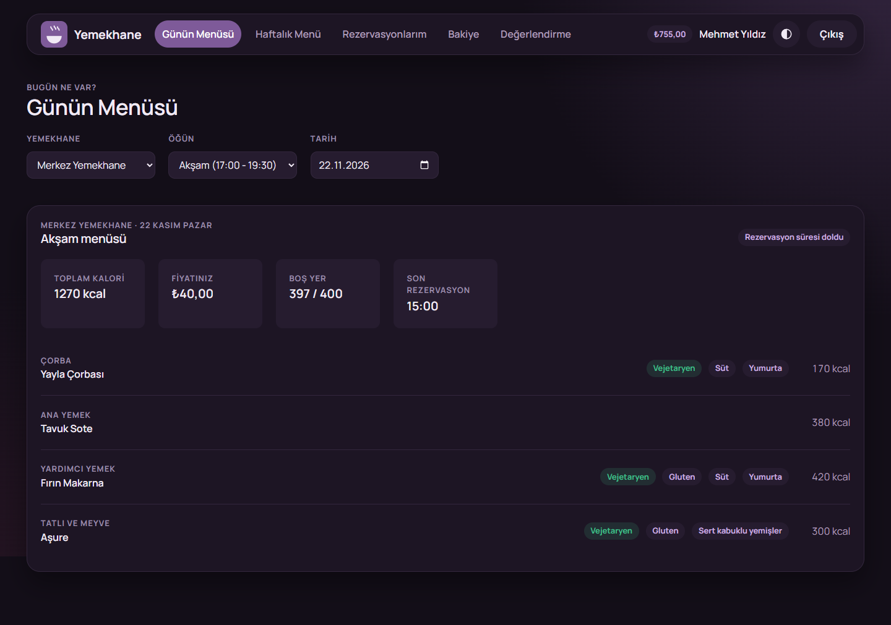
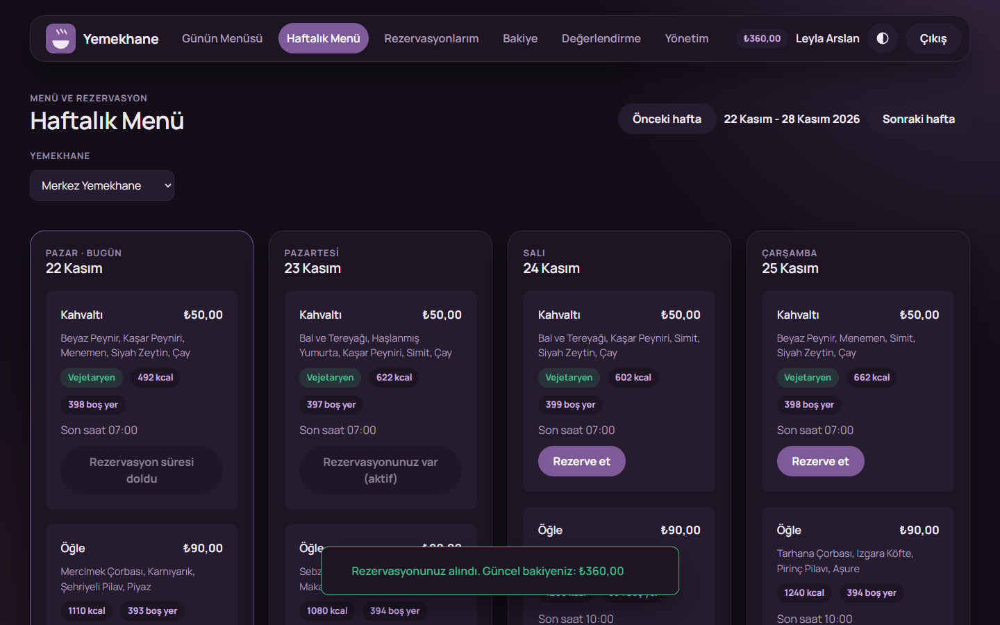
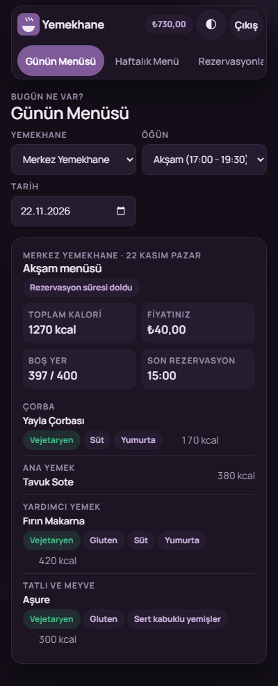

# Yemekhane Otomasyonu · Dönem Ödevi Raporu

| | |
|---|---|
| Ders | Web Teknolojileri |
| Öğrenci | Muhammed Şamil Özdemir, 241229001 |
| Depo | https://github.com/Muhammed-Samil-Ozdemir/Yemekhane-Otomasyonu |
| Seçilen yol | **Web API + HTML5/CSS3 arayüz** (ASP.NET Core 10, arayüz JavaScript `fetch` ile) |
| Etiketler | `asama-1`, `asama-2`, `asama-3`, `asama-4` |

## Aşama 1 · Altyapı

Başlangıç paketi değiştirilmeden çalıştırıldı (`docker compose up -d`).

```
$ docker compose ps -a
NAME                        SERVICE         STATUS
yemekhane-frontend-1        frontend        Up 25 seconds (healthy)
yemekhane-mysql-primary-1   mysql-primary   Up 25 seconds (healthy)
yemekhane-mysql-replica-1   mysql-replica   Up 26 seconds (healthy)
yemekhane-redis-1           redis           Up 25 seconds (healthy)
yemekhane-replica-setup-1   replica-setup   Exited (0) 3 seconds ago

$ docker compose logs replica-setup
[replica-setup] Replikasyon çalışıyor (IO=Yes, SQL=Yes). Replika salt okunur.

$ docker compose exec mysql-replica mysql -uroot -pyemekhane_kok -e "SHOW REPLICA STATUS\G"
           Replica_IO_Running: Yes
          Replica_SQL_Running: Yes
        Seconds_Behind_Source: 0
                Auto_Position: 1
```

**Kaynakta yapılan bakiye yüklemesi replikada görünüyor**

```
$ docker compose exec mysql-primary mysql -uyemekhane_app -pUyg_2026 yemekhane -e "CALL sp_bakiye_yukle(7, 100)"
hareket_id  bakiye
455         455.00

$ docker compose exec mysql-replica mysql -uyemekhane_app -pUyg_2026 yemekhane -e "SELECT id, bakiye FROM kullanicilar WHERE id = 7"
id  bakiye
7   455.00
```

**Replikaya yazma denemesi read-only hatasıyla reddediliyor**

```
$ docker compose exec mysql-replica mysql -uyemekhane_app -pUyg_2026 yemekhane -e "CALL sp_bakiye_yukle(7, 50)"
ERROR 1290 (HY000) at line 1: The MySQL server is running with the --super-read-only option so it cannot execute this statement
```

**Replika durdurulup başlatıldığında aradaki değişikliği yakalıyor**

```
$ docker compose stop mysql-replica
$ docker compose exec mysql-primary mysql -uyemekhane_app -pUyg_2026 yemekhane -e "CALL sp_bakiye_yukle(7, 200)"
hareket_id  bakiye
456         655.00
$ docker compose start mysql-replica
$ docker compose exec mysql-replica mysql -uyemekhane_app -pUyg_2026 yemekhane -e "SELECT id, bakiye FROM kullanicilar WHERE id = 7"
id  bakiye
7   655.00
           Retrieved_Gtid_Set: 83613c04-e6b5-11f1-9381-da8b70113a24:43-44
```

Replika kapalıyken yapılan işlem 44 numaralı GTID olarak geldi; replika açılınca `SOURCE_AUTO_POSITION = 1` sayesinde kaldığı yerden devam etti. Redis `PONG` döndü. Yordamların hata sözleşmesi de denendi: 12,50 TL bakiyeli kullanıcıyla `CALL sp_rezervasyon_yap(6, 80)` → `ERROR 1644 (45000): Bakiye yetersiz.`

## Aşama 2 · Uygulama

**Yol: Web API.** ASP.NET Core 10 yalnızca JSON döner. HTML5/CSS3 arayüz `frontend/` klasöründe durur ve veriyi `fetch` ile alır. Apache `-D WEBAPI` modunda `/api/` isteklerini `uygulama:8000` adresine iletir. Uygulama `docker-compose.yml` içinde `uygulama` servisidir ve bağlantı bilgilerini paketin tanımladığı `DB_*` ortam değişkenlerinden okur.

| Katman (`uygulama/`) | Sorumluluk |
|---|---|
| Domain | Varlıklar, rol ve durum sabitleri, repository arayüzleri |
| Application | MediatR command/query handler'ları, DTO'lar, `Result<T>`; rol fiyatı, son saat ve iptal hakkı burada hesaplanır |
| Infrastructure | Veri katmanı: Dapper ile SQL, stored procedure çağrıları, kaynak/replika bağlantı fabrikası |
| WebAPI | Controller'lar (SQL içermez), çerez tabanlı oturum doğrulaması, hata yakalayıcı |

**Bir isteğin yolu:** `POST /api/reservations`

```csharp
[HttpPost]
public async Task<IActionResult> Create(CreateReservationCommand request, CancellationToken cancellationToken) =>
    CreateActionResult(await mediator.Send(request, cancellationToken));

var receipt = await reservationRepository.CreateAsync(userContext.UserId, request.MenuId, cancellationToken);

await using var connection = await connectionFactory.OpenPrimaryAsync(cancellationToken);
var (reservationId, price, balance) = await connection.CallProcedureAsync<(int, decimal, decimal)>(
    "CALL sp_rezervasyon_yap(@UserId, @MenuId)", new { UserId = userId, MenuId = menuId }, cancellationToken);
```

Sırasıyla `ReservationController` → `CreateReservationCommandHandler` → `ReservationRepository` (kaynakta yordam) → `CustomBaseController.CreateActionResult`:

```
{"data":{"reservationId":370,"amount":40.00,"balance":690.00,"message":"Rezervasyonunuz alındı."},"isSuccess":true,"errorMessages":[],"status":201}
```

**Okuma/yazma ayrımı.** Yordamlar, menü oluşturma/düzenleme ve değerlendirme kaydı kaynağa; menüler, doluluk, rezervasyon listesi, bakiye hareketleri ve yönetici raporu replikaya gider. Günlükte haftalık menü (replika), rezervasyon (kaynak), aynı menüye ikinci deneme (kaynak, yordam reddetti) ve liste (replika) görülüyor:

```
23:52:07 dbug: ...DbConnectionFactory[0] Veritabanı bağlantısı: replika (mysql-replica)
23:52:10 dbug: ...DbConnectionFactory[0] Veritabanı bağlantısı: kaynak (mysql-primary)
23:52:10 info: ...AppExceptionHandler[0] İş kuralı reddetti: Bu menü için zaten rezervasyonunuz var.
23:52:10 dbug: ...DbConnectionFactory[0] Veritabanı bağlantısı: replika (mysql-replica)
```

**Rezervasyondan sonraki bakiye neden kaynaktan okunuyor?** Replikasyon eşzamansızdır: kaynak commit ettikten sonra değişiklik binlog üzerinden replikaya gider ve orada ayrıca uygulanır. Bu gecikme normalde milisaniyeler sürer ama yükte, ağ sorununda ya da replika yeniden başlarken saniyelere çıkabilir. Rezervasyondan hemen sonra bakiye replikadan okunsaydı kullanıcı düşülmemiş eski bakiyeyi görebilir, parasının çekilmediğini sanıp tekrar işlem yapabilirdi. Bu yüzden ekranda gösterilen bakiye `sp_rezervasyon_yap`'ın kaynakta aynı transaction içinde döndürdüğü `bakiye` değeridir; arayüz üst çubuktaki bakiyeyi bu değerle günceller. Bakiye sayfası daha sonra açıldığında liste replikadan gelir, o ana kadar replika yetişmiş olur.

**Hata mesajları.** Yordamın `SIGNAL SQLSTATE '45000'` mesajı `BusinessRuleException` olarak yakalanır, `{"isSuccess":false,"errorMessages":["Bakiye yetersiz."],"status":400}` biçiminde döner ve arayüzde bildirim olarak gösterilir. Arayüzde iş kuralı yoktur; düğmenin pasifliği (`isReservable`), rol fiyatı ve iptal hakkı (`canCancel`) API'den gelir.

**Ekranlar:** giriş/çıkış (bcrypt), günün menüsü, haftalık menü ve rezervasyon, rezervasyonlarım, bakiye, değerlendirme, yönetici paneli. Hepsi 400 px genişlikte yatay kaydırma olmadan kullanılır; koyu ve açık tema vardır. Diğer görüntüler `rapor/ekran/` klasöründe.







## Aşama 3 · Redis

| Görev | Anahtar | Süre | Silinme |
|---|---|---|---|
| Menü önbelleği | `menu:{yemekhane_id}:{tarih}:{ogun_id}` | Menünün gününün sonuna kadar | Yönetici menüyü oluşturduğunda ya da değiştirdiğinde |
| Oturum | `oturum:{token}` | 30 dakika, her istekte `GETEX` ile yenilenir | Çıkışta |

Bağlantı `REDIS_HOST` ve `REDIS_PORT` değişkenlerinden kurulur. Önbellekte kullanıcıdan bağımsız menü içeriği durur; rol fiyatı, boş yer ve kullanıcının rezervasyon durumu her istekte ayrıca hesaplanır.

**İlk istek veritabanından, ikincisi Redis'ten geliyor**

```
$ docker compose logs uygulama | grep Menü
23:54:34 info: ...MenuReader[0] Menü veritabanından (replika) okundu ve önbelleğe yazıldı: menu:1:2026-11-23:2
23:54:35 info: ...MenuReader[0] Menü Redis önbelleğinden okundu: menu:1:2026-11-23:2

$ docker compose exec redis redis-cli TTL menu:1:2026-11-23:2
86717
$ docker compose exec redis redis-cli GET menu:1:2026-11-23:2
{"CafeteriaId":1,"CafeteriaName":"Merkez Yemekhane","Date":"2026-11-23T00:00:00","MealId":2,"MealName":"Öğle", ...}
```

**Menü güncellenince eski kayıt siliniyor, arayüz yeni menüyü gösteriyor**

```
$ docker compose exec redis redis-cli EXISTS menu:1:2026-11-23:2
(integer) 1
$ curl -b yonetici.txt -X PUT -H "Content-Type: application/json" \
    -d '{"cafeteriaId":1,"date":"2026-11-23","mealId":2,"studentPrice":42,"staffPrice":90,"foodIds":[6,11,25,31]}' \
    http://localhost:8080/api/admin/menus/50
{"data":"Menü güncellendi.","isSuccess":true,"errorMessages":[],"status":200}
$ docker compose exec redis redis-cli EXISTS menu:1:2026-11-23:2
(integer) 0

23:55:02 info: ...ReplicaSynchronizer[0] Replika değişikliği uyguladı, önbellek güvenle silinebilir.
23:55:02 info: ...MenuCacheInvalidator[0] Menü değişti, önbellek kaydı silindi: menu:1:2026-11-23:2
23:55:03 info: ...MenuReader[0] Menü veritabanından (replika) okundu ve önbelleğe yazıldı: menu:1:2026-11-23:2
```

Öğrenci menüyü yeniden açtığında yeni hali gördü (42 TL, Çoban Salata yerine Cacık). Önbellek replikadan doldurulduğu için silme işlemi replika değişikliği uyguladıktan sonra yapılır: `ReplicaSynchronizer` kaynağın `@@GLOBAL.gtid_executed` değerini alıp replikada `WAIT_FOR_EXECUTED_GTID_SET` ile bekler. Aksi halde silmeden hemen sonra gelen istek replikadan eski menüyü okuyup gün sonuna kadar önbelleğe yazabilirdi.

**Uygulama container'ı yeniden başlasa da oturum düşmüyor**

```
$ docker compose exec redis redis-cli GET oturum:7520bd51...
{"UserId":2,"FullName":"Murat Kaya","Email":"murat.kaya@kampus.edu.tr","Role":"personel"}
$ docker compose exec redis redis-cli TTL oturum:7520bd51...
1797   (6 saniye sonra 1791, bir istekten sonra 1799)

$ docker compose restart uygulama
$ curl -b cerez.txt http://localhost:8080/api/auth/me
{"data":{"id":2,"fullName":"Murat Kaya", ...},"isSuccess":true, ...}

$ curl -X POST -b cerez.txt http://localhost:8080/api/auth/logout
{"data":"Çıkış yapıldı.","isSuccess":true,"errorMessages":[],"status":200}
$ docker compose exec redis redis-cli EXISTS oturum:7520bd51...
(integer) 0
```

Tarayıcı yalnızca rastgele 64 karakterlik token'ı `HttpOnly` bir çerezde tutar, kullanıcı bilgisi Redis'tedir. Aşama 2'de oturumlar uygulamanın belleğindeydi ve aynı `restart` herkesi çıkışa zorluyordu; değişiklik yalnızca Infrastructure'daki `ISessionService` kaydını `RedisSessionService` yapmaktan ibaret oldu.
